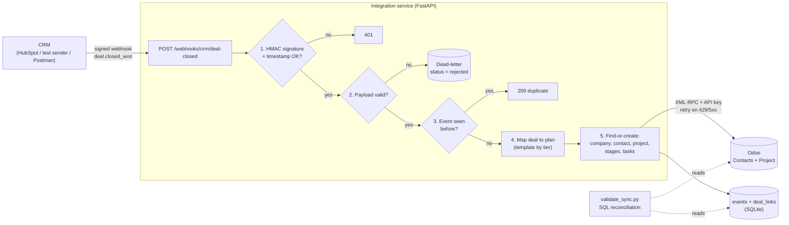
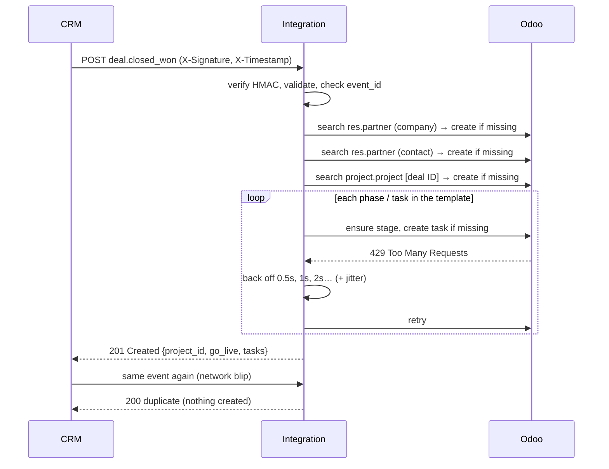

# CRM → Onboarding Integration

**When a sales deal is marked *Closed Won* in the CRM, automatically create the customer and a
ready-to-run onboarding project (phases, tasks, deadlines) in Odoo, then prove nothing was missed.**

This is the hand-off that every B2B SaaS implementation team deals with: Sales closes a deal and
Implementation has to start onboarding. Done manually, it is slow and error-prone (wrong plan,
missing contact, no kickoff date). This project automates it the way a production integration
should: authenticated, idempotent, retry-safe and auditable.

---

## Architecture





## How it maps to the job description

| JD requirement | Where it is in this project |
|---|---|
| REST APIs, webhooks, auth flows | `app/main.py` webhook endpoint · `app/security.py` HMAC + replay protection · Odoo API-key auth |
| Testing endpoints with Postman | `postman/crm-onboarding.postman_collection.json` (auto-signs requests, has assertions) |
| SaaS concepts: data models, API limits, auth | Odoo models (`res.partner`, `project.project`, `project.task`, `project.task.type`) · 429 handling · HubSpot pagination + `Retry-After` |
| Custom integrations between SaaS platforms | HubSpot → service → Odoo (`scripts/hubspot_poller.py`) |
| iPaaS (Make / Zapier / Workato) | Stage 3B: the same flow wired up in Make |
| Translating business workflows into configuration | `config/onboarding_template.json`: plan tier → phases/tasks/deadlines |
| Data validation, SQL | `scripts/validate_sync.py`: source vs target reconciliation in SQL |
| Escalations / risk | Dead-letter list with field-level reasons, so you know exactly what to ask the customer to fix |
| AI-first, builds own utilities | Built with AI-assisted development (see "How this was built") |

---

## Run it

### Stage 1: mock mode (5 minutes, no accounts)

The "Odoo" here is a local fake with the same API shape, so you can learn the flow first.

```bash
python -m venv .venv
# Windows:  .venv\Scripts\activate        macOS/Linux:  source .venv/bin/activate
pip install -r requirements.txt
copy .env.example .env          # macOS/Linux: cp .env.example .env

pytest -v                       # 12 tests: security, idempotency, retries, partial-failure repair

uvicorn app.main:create_app --factory --reload
```

In a second terminal:

```bash
python -m scripts.send_test_webhook              # send the sample deals
python -m scripts.send_test_webhook --replay     # send again: everything becomes "duplicate"
python -m scripts.send_test_webhook --tamper     # wrong secret: 401
python -m scripts.validate_sync                  # reconciliation report → reports/
```

Expected first run:

```
deal      HTTP  status       detail
HS-1001   201   created      project #3, 17/17 tasks, go-live 2026-12-10
HS-1002   201   created      project #29, 14/14 tasks, go-live 2026-12-11
HS-1003   201   created      project #46, 8/8 tasks, go-live 2026-12-14
HS-1004   422   rejected     deal.contact_email: Value error, not a valid email address
HS-1005   201   created      project #57, 14/14 tasks, go-live 2026-12-15
HS-1006   201   created      project #73, 14/14 tasks, go-live 2026-12-16
HS-1007   422   rejected     deal.plan: Input should be 'Starter', 'Growth' or 'Enterprise'
```

Things to try:
- Set `MOCK_FAILURE_RATE=0.3` in `.env`, restart, and watch the server log retry `429`s. The results don't change.
- Open **http://localhost:8000/docs** for the auto-generated API docs (OpenAPI/Swagger).
- Import the Postman collection and run it top to bottom.
- **Fix-and-replay:** correct HS-1004's email in `samples/deals.json`, re-send, then re-run `validate_sync`. That's the dead-letter recovery loop.

### Stage 2: real Odoo 17 in Docker

```bash
docker compose up -d            # then open http://localhost:8069
```
1. Create a database named `onboarding` and note the login email you choose.
2. Install the **Project** app (Contacts comes with it).
3. Avatar (top right) → **My Profile / Preferences → Account Security → New API Key**. If you don't
   see it, enable *Developer mode* in Settings first.
4. In `.env`: `ODOO_MODE=live`, `ODOO_USER=<your login email>`, `ODOO_API_KEY=<key>`.
5. Restart the server and send the deals again. In Odoo → Project you'll see each onboarding project, with
   phases as Kanban columns and tasks with deadlines.

*(An Odoo Online free trial works too: set `ODOO_URL=https://<yours>.odoo.com` and `ODOO_DB=<yours>`.)*

### Stage 3A: real CRM (HubSpot free) via polling

Setup steps are at the top of `scripts/hubspot_poller.py`. Create a private app, put its token in `.env`, then:
```bash
python -m scripts.hubspot_poller --loop 60
```

### Stage 3B: same flow in Make (iPaaS, no code)

1. Expose your local service: `ngrok http 8000` → copy the https URL.
2. Make scenario: **HubSpot CRM › Watch Deals** (filter: stage = Closed Won) →
   **Tools › Set variables**:
   - `ts = {{formatDate(now; "X")}}`
   - `body` = the JSON event (map the deal fields)
   - `sig = sha256=` + `{{sha256(ts + "." + body; "hex"; "<your WEBHOOK_SECRET>")}}`
   → **HTTP › Make a request** (POST, raw JSON body, headers `X-Timestamp` and `X-Signature`).
3. Turn on Make's error handler with a retry on 503. The service returns 503 only for retryable failures.

> Check Make's current function docs for `sha256` with a key argument (HMAC). Function names do change.

---

## Design decisions (be ready to explain each in an interview)

1. **HMAC signature + timestamp, not just an API key in a header.** A key proves who you are. A signature also
   proves the body wasn't changed, and the timestamp window blocks replaying a captured request. Stripe, Slack
   and HubSpot all use this pattern.
2. **Idempotency at two levels.** (a) `event_id`: the same delivery twice → `duplicate`. (b) Every Odoo write is
   *find-or-create*, so even a *new* event for the same deal changes nothing.
   Webhook senders guarantee *at-least-once* delivery, not *exactly-once*.
3. **Reconcile, don't blindly create.** If the process dies after creating 5 of 17 tasks, re-sending repairs the
   project (`status: repaired`) instead of making a second one. See `test_partial_failure_is_repaired_without_duplicates`.
4. **Retry only what can succeed on retry.** 429/5xx/timeouts → exponential backoff with jitter, honour `Retry-After`.
   Validation or permission errors → fail immediately; retrying can't fix bad data.
5. **Status codes are a contract with the sender.** `401` fix the secret · `422` fix the data (don't retry) ·
   `503` retry later · `200 duplicate` already done. The sender's retry logic depends on these.
6. **Dead-letter, not silent drop.** Rejected events are stored with field-level reasons (`GET /events`). That
   gives you a list of specific fixes to ask the customer for, instead of "some projects are missing".
7. **Business rules live in config.** Plan tier → phases/tasks lives in `onboarding_template.json`, so changing the onboarding
   playbook needs no code change. This is what "translating workflows into configuration" means in practice.
8. **Reconciliation is part of go-live.** `validate_sync.py` answers "did everything sync?" in SQL:
   missing, orphans, duplicates, field mismatches, wrong task counts. It exits with code 1 so it can run on a schedule.

**Thin vs fat webhooks:** HubSpot's native webhooks are *thin* (they send "deal 123 changed"), so you call the API
back to fetch details. This service accepts a *fat* event (all the fields in the payload) because the poller and Make
build it. Know both.

## What I'd change for production

- Return `202 Accepted` immediately and process from a **queue** (SQS/RabbitMQ/Redis), so slow Odoo calls never time out the sender.
- Secrets in a vault, not `.env`. OAuth 2.0 where the target supports it. Rotate the webhook secret.
- Alert (Slack/email) when the dead-letter list grows, and track success rate and latency on a dashboard.
- Map the deal owner to the Odoo project manager (`res.users` lookup by email).

## Project layout

```
app/
  main.py          HTTP layer: auth → validate → idempotency → service → status codes
  security.py      HMAC-SHA256 signing/verification with replay window
  models.py        event contract + validation rules (pydantic)
  mapping.py       deal → onboarding plan (business days, tier-based tasks)
  service.py       find-or-create orchestration against Odoo
  odoo_client.py   Odoo XML-RPC client, retry/backoff, and MockOdoo
  store.py         SQLite: event log / dead-letter, deal↔Odoo ID map
config/onboarding_template.json   the onboarding playbook
scripts/send_test_webhook.py      plays the CRM
scripts/validate_sync.py          SQL reconciliation report
scripts/hubspot_poller.py         real HubSpot source (Stage 3A)
postman/                          Postman collection
tests/                            pytest suite (12 tests)
docker-compose.yml                Odoo 17 + Postgres
```

## How this was built

Built with AI-assisted development (an AI coding assistant), then run, tested and extended by me.
*(Update this section honestly with what you changed yourself.)*
